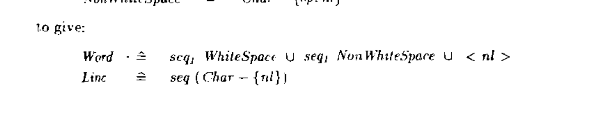
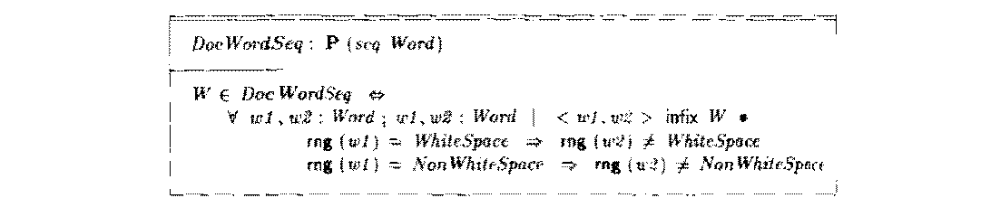
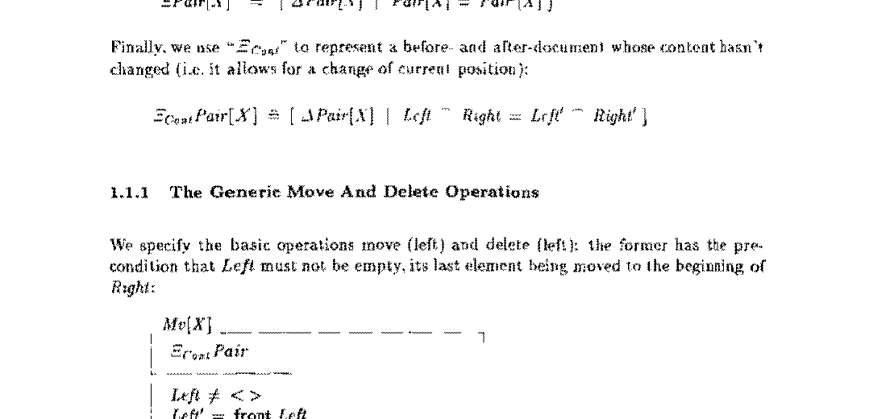
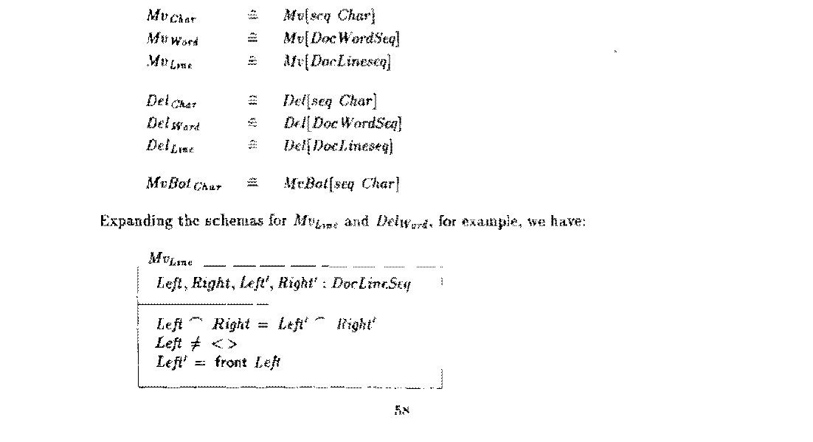
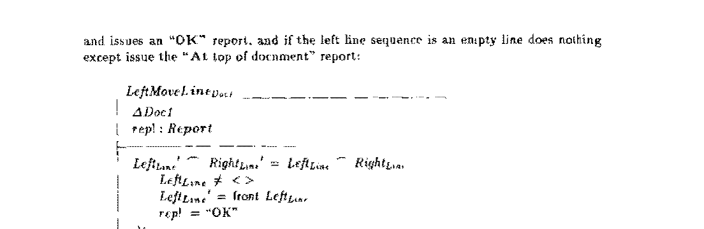

# Findings tracker

Problems in the printed specification found by the formalisation. The detailed write-ups are in `README.md` ("What the formalisation found"); the evidence is in the Lean files. **Decisions are deliberately left open** until the whole specification has been worked through.

Severity:
- **stuck**: a user action has no correct outcome (only an error, or no outcome at all)
- **unsafe**: an operation may do something it should not
- **ill-formed**: the Z does not type-check or is undefined as written; the intent is clear
- **weak**: the spec allows behaviour its own text says it should not
- **minor**: errors in the book's informal proofs or naming, no effect on the spec's meaning

For each finding the Lean development currently uses the reading shown in "Reading used". For **stuck** and **unsafe** problems, both the printed version and the corrected version are defined.

| # | § | Finding | Severity | Lean evidence | C behaviour | Reading used | Decision |
|---|---|---|---|---|---|---|---|
| 1 | 1.2 | `Line ≙ seq (Char − {nl})` excludes the newline lines the book's own examples use; line views then don't exist (or aren't unique) | ill-formed | `printed_lines_have_no_nl`, `printed_lines_not_unique` | n/a | `seq₁ (Char − {nl}) ∪ {⟨nl⟩}` | **Fixed** to the intended definition ([D1](#d1-what-a-line-is)) |
| 2 | 1.2 | `DocWordSeq` uses `rng w = NonWhiteSpace` where `⊆` is meant: the rule never applies, so word views are not unique and Corollary 3:1.2a fails | ill-formed | (comment in `DocWordSeq`) | n/a | `⊆` | **Fixed**: read `=` as `⊆` ([D2](#d2-telling-words-apart)) |
| 3 | 1.6 | Word and line moves are not total: inside a word or line there is no outcome at all | stuck | `leftMoveWord_Doc1_stuck` | moves (`LeftMoveWord_Doc1`) | C reading (`MvWordC`, `MvLineC`), content kept as characters | **Fixed** ⚠ follows the C ([D3](#d3-moving-by-a-word-or-a-line)) |
| 4a | 3.3 | `RemTrailWS` is declared on `ΔUD` but uses `Left_Char`/`Right_Char` | ill-formed | (definition on `ΔDoc2`) | n/a | `ΔDoc2` | open |
| 4b | 3.1 | `visibleseq` uses `last L` on a possibly empty sequence | ill-formed | (comment in `visibleseq`) | n/a | empty sequence is a visibleseq, as the prose says | open |
| 4c | 3.1 | The empty-line invariant allows one invisible empty line at the end of the document, contrary to its stated purpose | weak | `Check.lean` | removes it | at most one empty line at the end | **1990:** as the C, empty lines at the end removed; **2026:** the final newline kept ([D4](#d4-the-newline-at-the-end-of-a-file)) |
| 4d | 2.2 | Consistency proof says `Uₙ = ⟨l, r⟩` for `l ⁀ r`; Lemma 3:2.2d cites lemmas that don't exist | minor | `FDLinv_append`, `Initialize_Doc2_display` | n/a | n/a | open |
| 5 | 4.2.2 | → (`CursorRightChar`) after typing a space at the end of a line can only answer "Editor full"; `PadWSNL` is not total as claimed | stuck | `cursorRight_after_space`; `Check.lean` (3,581 cases, all this one) | inserts a space and moves | both defined (`PadWSNL`, `PadWSNLC`) | **Fixed** ⚠ follows the C ([D9](#d9-the-follow-the-c-decisions)) |
| 5b | 4.2.2 | Padding may add surplus spaces that the tidying operations don't remove; only `ΔDoc4` excludes them | minor | (README) | pads exactly | as printed | open |
| 6a | 5.2 | Paste can only answer "Editor full": `Pst` sets `MarkedSeq′ = ⟨⟩` instead of `PBuff`, breaking the `MarkedText` invariant | stuck | `pst_impossible`, `paste_only_full` | marks the pasted text | both defined (`Pst`, `PstC`) | **Fixed** ⚠ follows the C: the mark as a position ([D5](#d5-how-the-mark-is-remembered)) |
| 6b | 5.2 | Cut with the mark below the cursor may replace the whole document (`Left_Char` for `Right_Char`, #313) | unsafe | `remMText_mark_below_unconstrained` | removes the marked text | both defined (`RemMText`, `RemMTextC`) | **Fixed** ⚠ follows the C: the mark as a position ([D5](#d5-how-the-mark-is-remembered)) |
| 6c | 5.2 | Cut has no outcome at all when the marked text repeats the text before the mark (e.g. "aa\|", mark in the middle) | stuck | `remMText_both_premises`, `cut_no_outcome` | removes the marked text | both defined | **Fixed** ⚠ follows the C: the mark as a position ([D5](#d5-how-the-mark-is-remembered)) |
| 6d | 5.1 | A mark set at the top of the document is indistinguishable from no mark; as printed, cursor moves may create a mark from nothing | weak | `setMark_at_top`, `cursorOp_mark_unconstrained` | `MP = −1` for no mark | as printed | **Fixed** ⚠ follows the C: the mark as a position ([D5](#d5-how-the-mark-is-remembered)) |
| 6e | 5.1 | The `MarkedText` state does not always say which side of the cursor the mark is on: in "ab\|ba" with `MarkSeq = ⟨a⟩`, `MarkedSeq = ⟨b⟩`, the mark may be one place back or one place on. Cut then has no outcome, even with the `Left`/`Right` slip (6b) repaired. Found by stating the claim "Cut then Paste gives the document back" (`Claims.lean`), which the monograph never states | stuck | `mark_side_ambiguous`, `remMTextC_no_outcome`; with the mark as a position the claim is proved for every document (`cut_then_paste`) | keeps the mark as a position `MP` | our first fix (`RemMTextC`) is affected; the mark-as-position model is not yet adopted | **Fixed** ⚠ follows the C: the mark as a position ([D5](#d5-how-the-mark-is-remembered)) |

| 7a | 6.4.4 | Quit has no outcome unless the whole document is marked: `RequestQuit` says both `WriteSeq! = MarkedSeq` and `WriteSeq! = Left_Char ⁀ Right_Char` | stuck | `quit_stuck` | writes the document if changed, then exits | as printed | **Fixed** ⚠ follows the C ([D9](#d9-the-follow-the-c-decisions)) |
| 7b | 6.5 | Move-to-line can never run: `MoveLineNumber_Quote` is missing from `Quote_StateQuote`, and a number is valid quote text, so it is not a "Quote error" either. The empty command (quote key pressed twice) is stuck the same way | stuck | `moveToLine_stuck`, `emptyQuote_stuck` | `MoveLineNumberOrError_Quote` is the fall-through case | as printed | **Fixed** ⚠ follows the C ([D9](#d9-the-follow-the-c-decisions)) |
| 7c | 6.4 | Input has no outcome while text is marked: `QuoteRequestContentChange` has unprimed `MarkedSeq = ⟨⟩` | stuck | `input_marked_stuck` | reads the file | as printed | **Fixed** ⚠ follows the C ([D9](#d9-the-follow-the-c-decisions)) |
| 7d | 6.2 | `SysRead` is inverted (`¬ NoReadError! ⇒ ReadSeq! = …`): a successful read may return any text | unsafe | `sysRead_success_any` | returns the file | as printed | **Fixed** ⚠ follows the C ([D9](#d9-the-follow-the-c-decisions)) |
| 7e | 6.2–6.6 | Error branches leave the file store, the document or the document name unconstrained (Z schema disjunction): "Cannot open file" may change any file; a failed Input may replace the document with anything; "Document not changed" may change any file; editing the quote buffer may rename the document | unsafe | `writeToStore_cannot_open_any`, `input_error_any_document`, `save_any_store`, `quoteEdit_any_name` | n/a | as printed | **Fixed** ⚠ follows the C ([D9](#d9-the-follow-the-c-decisions)) |
| 7f | 6.4.2, 6.4.4 | No record of whether the document has changed, so Save and Quit may always answer "Document not changed"; Quit may exit without saving edits | unsafe | `save_any_store` | `DocChanged` flag | as printed | **Fixed** ⚠ follows the C: a changed flag, as `DocChanged` ([D6](#d6-remembering-whether-the-document-has-changed)) |
| 7g | 6.2–6.7 | Undefined or ill-typed names: `DocCurX′`/`DocCurY′`, `ExchMTextPBuff`, `CursorLeftChar_Quote`/`CursorRightChar_Quote`, `rep!` in `ErrorIllegalQBuffEditOp`, `SysReturnControl` composed as if a schema, `ΔDocI`, `UnsuitableFile`, `SuccGetSysPtr` | ill-formed | (comments in `Doc7.lean`) | n/a | obvious readings | open |
| 7h | 6.2, 6.4.6 | `SysGetPtr` does not relate the pointer to the file name, so files are not identified by name (saving then reading the same name need not give the text back); `RequestMvLineNumber` leaves the document content unconstrained; line number 0 gives `UDCurY′ = 0`, which has no outcome | weak | (comments in `Doc7.lean`) | n/a | as printed | **Decided, to discuss** ⚠ follows the C: use the real file system ([D7](#d7-files)) |

| 8a | 7.5 | Replace cannot replace: `PromoteReplace` contains `Ξ_Cont Doc1` (content unchanged), so a successful Replace leaves the document as it was; at a match the only general answer is "Editor full" | stuck | `replace_ok_unchanged` | replaces | as printed | **Fixed** ⚠ follows the C ([D9](#d9-the-follow-the-c-decisions)) |
| 8b | 7.3 | Search with a mark set has no outcome when the text is found: `PromoteSearchUnMark` has unprimed `MarkSeq = ⟨⟩` (same in `PromoteReplaceUnMark`) | stuck | `downSearch_marked_stuck`, `replace_marked_full` | searches; the mark is adjusted | as printed | **Fixed** ⚠ follows the C ([D9](#d9-the-follow-the-c-decisions)) |
| 8c | 7.3 | Search from a line ending in a space has no outcome when the text is on another line: `PromoteSearch` also contains `Ξ_Cont Doc1`, which forbids the tidying the Doc3 invariant then requires (the prose itself says a search may remove whitespace) | stuck | `xiCont_other_line_visible` | searches and tidies | as printed | **Fixed** ⚠ follows the C ([D9](#d9-the-follow-the-c-decisions)) |
| 8d | 7.3–7.4 | A down search may move the cursor up (and an up search down): "first match" is stated as an empty range when the match is behind the cursor; nothing requires moving forward | unsafe | `downSearch_may_go_up` | searches forward from the cursor | as printed | **Fixed** ⚠ follows the C ([D9](#d9-the-follow-the-c-decisions)) |
| 8e | 7.2–7.5 | `regexpmatches` constraint `# e ≥ s` does not type-check; `matches` uses an undefined `s`; `matchedlength` has only its domain specified, so the amount of text a Replace removes is unconstrained; `CopyQBuffRBuff` renames schemas instead of variables; `ErrorReplaceFull_Doc` lacks `rep!`; the disjunct grouping of the search/replace operations contradicts Z precedence | ill-formed | (comments in `Doc8.lean`) | n/a | layout grouping; `matchedlength` a parameter | open |
| 9a | 8.2 | Lemma 3:8.2a ("the character under the window cursor is the one under the display cursor") is undefined when the cursor is after the last character of its line, which is always the case in the empty document; proof step 8 (and 8.2c step 6) mix up `WinWidth` and `WinHeight`; `Window` writes `# WinLines` | minor | `Doc9.char_at_cursor` (the true, partial-indexing form) | n/a | partial indexing | open |
| 9b | 8.2.1 | `HalfWinHeight = WinHeight/2` is said to be at least 1, but is 0 for a one-line window; Centre Window then has no outcome | stuck (edge case) | `centreWindow_height_one`; total for `WinHeight ≥ 2` (`CentreWindow_Doc9_total`) | n/a | as printed | **1990:** the smallest repair, `max 1 (WinHeight/2)`; **2026:** the true middle line ([D8](#d8-centring-the-window)) |
| 9c | 8.2.2 | "We thus discharge PO 1 for each Doc8 operation": the window policy is total (proved), but this only carries totality up from Doc8, where it already fails for findings 3, 5, 6, 7 and 8 | minor | `WindowPolicy_total`, `promote9_total` | n/a | n/a | open |
| N1 | 3.3 | Moving the cursor deletes text: type "a␣", press ← and the space is deleted (no trailing spaces right of the cursor), so "a␣", ←, →, "b" gives "ab". Found by stating a claim; see `issues_notdefined.md` (C7) | weak (by design) | `step_back_deletes_space`; confirmed on the running editor | does the same | as printed | **As the specification** (and the C) ([D10](#d10-keep-what-the-specification-asks-for)) |
| N2 | 3.3 | Enter then Backspace in "ab␣\|cd" gives "abcd": the space between the words is lost. See `issues_notdefined.md` (C8) | weak (by design) | `enter_backspace_loses_space`; confirmed on the running editor | does the same | as printed | **As the specification** (and the C) ([D10](#d10-keep-what-the-specification-asks-for)) |
| N3 | Part 2 §4 | No operation is ever required to succeed: "Editor full" is always a permitted answer to insert, Paste and the cursor moves, so an editor that refuses them all meets the spec. See `issues_notdefined.md` (C2) | weak | `insert_may_always_refuse`, `paste_may_always_refuse`, `cursorDown_may_always_refuse` | inserts when there is room | as printed | **As the specification** (and the C) ([D10](#d10-keep-what-the-specification-asks-for)) |

## Decisions

How each decision was reached, with the evidence from the scan.

**Policy when following the C.** Where the printed specification gives no usable answer, and the C program printed in the same monograph shows what the author intended, we follow the C. Every such decision is marked **⚠ follows the C** in the table above and carries a warning at the top of its section. The warning says what we changed, why the printed specification cannot be used as it stands, and that the result is our reading of the author's intent rather than his text. Anyone who prefers the printed text can find both versions in the Lean code: the printed one under its original name, the C's version with a `C` suffix (for example `MvWord` and `MvWordC`).

**The principle: spec-based development, in two editions.** This project is about building software from a specification, not about building the best editor. So the main edition, the **1990 edition**, does what the specification says, even where that now looks wrong, and is repaired only where the specification itself is broken. Decisions follow these rules, in order:

1. **The specification says X and the C agrees: do X**, even if it looks wrong today, and record why (for example D10).
2. **The specification is broken** (stuck, contradictory or unconstrained) **and the C shows the intent: follow the C**, marked ⚠ (D3, D5, D6, D9).
3. **The specification leaves a choice open: take the C's choice** (tab stops every 8 columns; empty lines at the end removed, D4).
4. **Neither says: make the smallest choice** and record it (D7).
5. **A modern improvement goes into the 2026 edition only** (D4, D8, Quit; see "Two editions" in `README.md`).

Both editions are built from the same code: `zeditor` is the 1990 edition and `zeditor2026` the 2026 edition. (Decisions D4 and D8 were first made as "modern convention" changes to the one editor; under this principle they were revised on 2026-10-31 so that the 1990 edition follows the C and the change lives in the 2026 edition.)

### D1. What a line is

*Finding 1. Decided 2026-10-30: fix to the intended definition.*

**What the monograph says.** §1.2 (printed p.55, PDF p.58) defines

    Line ≙ seq (Char − {nl})

that is, a line is any sequence of characters that contains no newline (`nl`), including the empty sequence.



**Why it is contradictory.** Two pages later (printed p.57, PDF p.60) the monograph gives its own example of the line view of a document. It takes the characters


that is, "the⏎canary⏎⏎ate", and splits them into the lines

    ⟨⟨t,h,e⟩, ⟨nl⟩, ⟨c,a,n,a,r,y⟩, ⟨nl⟩, ⟨nl⟩, ⟨a,t,e⟩⟩

in which every newline is a line of its own. By the definition on p.55, `⟨nl⟩` is not a line, so this example is not a line view. The very next definition, `DocLineSeq`, also tests whether a line equals `⟨nl⟩`, which no line could. The definition and the way it is used contradict each other. Taken literally:

- a document containing any newline has no line view at all, so moving or deleting by line is undefined for every multi-line document (`printed_lines_have_no_nl`);
- because empty lines are allowed, even the empty document has two different line views, `⟨⟩` and `⟨⟨⟩⟩`, so the function `FL` that the monograph declares one-to-one is not (`printed_lines_not_unique`), and Corollary 3:1.2c is false.

**What was intended.** The example, `DocLineSeq`, the lemmas of §1.2.2 and the C (`LeftMoveLine_Doc1` moves over a single newline, or back to the start of the line) all treat a line as *either a non-empty run of characters other than newline, or a single newline on its own*.

**Decision.** Use the intended definition:

    Line ≙ seq₁ (Char − {nl}) ∪ {⟨nl⟩}

This is `IsLine` in `ZEditor/Spec/Doc1.lean`. With it, every document has exactly one line view (proved: `lines_ok`, `DocLineSeq.unique`, `FL_lines`).

### D2. Telling words apart

*Finding 2. Decided 2026-10-30: read `=` as `⊆` (subset).*

**What the monograph says.** The box defining `DocWordSeq` (printed p.56, PDF p.59) says that in a valid word view no two adjacent words `w1`, `w2` are of the same kind:



    rng (w1) = WhiteSpace     ⇒  rng (w2) ≠ WhiteSpace
    rng (w1) = NonWhiteSpace  ⇒  rng (w2) ≠ NonWhiteSpace

`rng w` is the set of characters occurring in the word `w`. `WhiteSpace` is `{sp}`; `NonWhiteSpace` is every character except space and newline.

**Why it does not work as printed.** The symbol really is a plain `=` (confirmed by eye); the problem is its meaning, not its printing. The first line is fine: a word of spaces has exactly `{sp}` as its set of characters. The second line never applies: `rng (w1) = NonWhiteSpace` would need the word to contain *every* character other than space and newline, which no word does. So nothing forbids two non-space words next to each other, and "cat" has several word views, for example `⟨⟨c,a,t⟩⟩` and `⟨⟨c,a⟩,⟨t⟩⟩`. The corollary printed immediately below the box (Corollary 3:1.2a, "as a direct consequence of this definition … the sequences themselves are equal") is then false.

**Could we be wrong?** Possibly the author used `=` loosely, meaning "the word's characters are all of this kind"; written mathematics often does. That is exactly the `⊆` reading we adopt, so the question is only whether to call this an error in the text or an informal use of `=`. Taken strictly, as Z defines `=`, it is an error: the monograph's own corollary needs `⊆`. Read as `⊆`, the first line means the same as printed (a non-empty word whose characters are drawn from `{sp}` has exactly `{sp}`), and the second line gains the meaning the corollary needs. No other reading we can find makes the corollary true.

**Decision.** Read both lines with `⊆`:

    rng (w1) ⊆ WhiteSpace     ⇒  ¬ (rng (w2) ⊆ WhiteSpace)
    rng (w1) ⊆ NonWhiteSpace  ⇒  ¬ (rng (w2) ⊆ NonWhiteSpace)

This is `DocWordSeq` in `ZEditor/Spec/Doc1.lean`. With it, every document has exactly one word view (proved: `words_ok`, `DocWordSeq.unique`, `FW_words`), which is Corollary 3:1.2a.

### D3. Moving by a word or a line

*Finding 3. Decided 2026-10-30: adopt the C's behaviour. A move keeps the text unchanged as characters, not as words or lines.*

> **⚠ This decision follows the C, not the printed specification.**
>
> As printed, moving left or right by a word or a line has **no result** whenever the cursor is inside a word or a line. The specification gives neither a move nor an error, so it does not say what the editor should do. We have made the editor do what the C program in the same monograph does: move to the start (or end) of the word or line. We believe this is what the author intended (he defines the necessary rule himself, in §1.3, but does not use it here). It is nevertheless our reading, not his text. The printed operations are kept in the Lean code as `MvWord` and `MvLine`, next to the versions we use, `MvWordC` and `MvLineC`.

**What the monograph says.** §1.1.1 (printed p.54, PDF p.57) defines one generic move, `Mv[X]`. It works on a pair `Left`, `Right` of sequences of `X`: "*Left* must not be empty, its last element being moved to the beginning of *Right*". The text is kept unchanged by `Ξ_Cont`, "a before- and after-document whose content hasn't changed (i.e. it allows for a change of current position)", defined as `Left ⁀ Right = Left′ ⁀ Right′`:



§1.2.1 (printed p.58, PDF p.61) then uses the same move for characters, words and lines: `Mv_Word ≙ Mv[DocWordSeq]`, `Mv_Line ≙ Mv[DocLineSeq]`. Its expansion of `Mv_Line` shows what that means: `Left`, `Right`, `Left′` and `Right′` must all be valid line sequences, and the content is kept unchanged *as a sequence of lines*:



§1.6, "The Total Operations On The Doc1 State", then defines, for example, `LeftMoveWord_Doc1 ≙ (LeftMvWord ∧ Success) ∨ ErrorTopOfDoc`. "Total" means the operation always has an outcome. Its expansion for lines (printed p.68, PDF p.71):



**Why it gets stuck: an example.** Take the document "cat" with the cursor between `a` and `t`: "ca|t".

- Seen as words, the cursor splits the word: `Left` is the one word "ca", and `Right` is the one word "t".
- Move left by a word: the last word of `Left`, "ca", moves to the front of `Right`, so `Right′` would be the two words "ca", "t".
- But two letter-words side by side are not a valid word sequence. That is exactly what the word rule forbids (see D2), and `Right′` must be valid. So there is no allowed result.
- The error case, `ErrorTopOfDoc`, applies only when the cursor is at the top of the document, and here it is not.

So the operation has **no outcome at all**: not a move, not an error message. The same happens for lines: in "ab|c", moving left by a line would make `Right′` the two text lines "ab", "c" with no newline between them, which `DocLineSeq` forbids. This happens whenever the cursor is inside a word or a line, which is most of the time. Lean proves it for "ca|t" (`leftMoveWord_Doc1_stuck`).

**What the C does.** `LeftMoveWord_Doc1` (Appendix C, p.ii) moves the cursor back over a newline, a run of spaces, or the rest of the word, and always succeeds unless the cursor is at the top:

```c
int LeftMoveWord_Doc1()
{
 if (CP!=0) { if       (GetArrCont(CP)==nl) { CP--; }
              else if (GetArrCont(CP)==sp) { LMWSWord(); }
              else                         { LMNWSWord(); }
              return(OK);
            }
 else       { return(Top); }
}
```

From "ca|t" it moves to "|cat". `LeftMoveLine_Doc1` does the same for lines.

**What was intended.** The move should keep the text unchanged *as characters*, and the word and line views on each side are then recomputed from the characters. In the example, "ca" joins "t" and becomes the word "cat". The monograph defines exactly this in §1.3 as `Ξ_Cont Doc1 ≙ Ξ_Cont Pair[Char] ∧ ΔDoc1`, but does not use it for the moves.

**Could we be wrong?**
- For words, the problem only appears once the word rule works as intended (D2). With the printed `=` (finding 2), "ca" next to "t" would be allowed and the move would succeed, so one could argue that the two errors cancel out. They do not fully. With the printed rule a document's word view is not unique, so the monograph's Corollary 3:1.2a fails. And nothing rescues lines: the line rule `DocLineSeq` is printed correctly, and forbids two text lines side by side under either definition of a line (D1).
- Perhaps the author meant word and line moves to be used only at word or line boundaries. But nothing in the specification restricts the cursor in that way. Character moves put it inside words, and §1.6 calls these operations total. The C moves from anywhere.

**Decision.** Use the C's behaviour. A word move keeps the characters unchanged (`Ξ_Cont Doc1`), requires `Left_Word ≠ ⟨⟩`, and sets `Left_Word′ = front Left_Word`; the same for lines. These are `MvWordC` and `MvLineC` in `ZEditor/Spec/Doc1.lean`. Lean proves that this gives the C's result ("ca|t" to "|cat", `leftMvWordC_caT`), and that with it all fifteen operations of §1.6 are total (`LeftMoveWordC_Doc1_total` and the others in `ZEditor/Spec/Total.lean`).

### D4. The newline at the end of a file

*Finding 4c. Decided 2026-10-31, revised the same day under the two-editions principle: the **1990 edition** follows the C and removes empty lines at the end of the document, including a file's final newline; the **2026 edition** keeps the final newline.*

> **The 1990 edition takes the C's choice; the 2026 edition follows current practice.**
>
> The specification leaves it open whether a document keeps its final newline (and only in one case); the C removes it, which the specification allows, so the 1990 edition does the same (rule 3). Today a text file ends with a newline by convention, so the 2026 edition keeps it.

**Background.** Doc3 (§3.1, printed p.76) forbids empty lines at the end of the document, because on a 1990 terminal they cannot be seen. After every key the tidying operation `RemTrailNL` removes them. In the specification's model of lines, a file that ends with a newline, `abc⏎`, is two lines: `abc` and an empty one. So the final newline *is* an empty line at the end.

**What the specification says.** The rule (`visibleseq`, applied to the lines below the cursor) makes one exception: if *every* line below the cursor is empty, one may remain. So the final newline *may* survive, but only while the cursor is on the last line of text, and even then the specification leaves the choice open. With the cursor anywhere higher, as in `abc⏎def⏎` with the cursor on `abc`, the empty last line must go. (An earlier note in this project said the printed rule keeps the final newline; it does so only in that one case.)

**What the C does.** Its `RemTrailNL` removes every empty line at the end, so `abc⏎` becomes `abc` after the first key. Our first prototype copied this, and so opening a file, pressing → once and saving deleted its final newline.

**Why it matters now.** In 1990 this looked like tidiness. Today a file ending in a newline is the standard convention (POSIX defines a line as ending in a newline). Removing it makes `wc -l` count one line fewer, makes git report "No newline at end of file", and trips up tools that read the last line.

**Decision.**
- **1990 edition:** as the C, every empty line at the end of the document is removed by the tidying, so a file's final newline is removed after the first key (`tests/final_newline.sh`, first three cases).
- **2026 edition:** at most one empty line may remain at the end: the final newline is kept wherever the cursor is, and any further empty lines at the end are tidied away. A file that did not end with a newline is left as it is (adding one on save, as vim and nano do, would be a further change).

**Evidence.**
- The Doc3 proof obligation still holds with the changed rule. Checked exhaustively: no failures in 2,639 states, from all documents of up to 6 characters, for all operations (`Check.lean`, `failuresD4`).
- The tidying never removes a final newline that an operation left in place: 0 cases with the new rule, against 10,013 (state, key) cases with the C's rule (`finalNewlineLostD4`, `finalNewlineLostC`).
- On the running editor: `tests/final_newline.sh` (four cases, including the cursor above the end of the document).
- In the editor's code: `keepFinalNewline` in `ZEditor/Impl/Editor.lean`. The Lean specification (`Doc3.lean`) still states the printed rule; it will be changed when the editor is proved against the corrected specification.

### D5. How the mark is remembered

*Findings 6a, 6b, 6c, 6d and 6e. Decided 2026-10-31: the mark is a position in the text, as in the C. Any edit clears it, as the specification and the C both say. A cursor move keeps it on the same text, as the C does.*

> **⚠ This decision follows the C, not the printed specification.**
>
> The specification records the mark as two pieces of text, `MarkSeq` and `MarkedSeq`. That representation is the cause of five findings: Paste can only answer "Editor full" (6a); Cut with the mark below the cursor may rewrite the document (6b); Cut can have no outcome at all (6c); a mark at the top of the document is the same as no mark (6d); and in some states the representation does not say which side of the cursor the mark is on (6e). The C records the mark as a position `MP` in the text, with `MP = −1` meaning no mark, and none of these can happen. We follow the C. It is our reading of the author's intent, not his text.

**Background.** The mark is one end of a selection: set it, move the cursor, and the text between the mark and the cursor is marked, ready to copy (Lift), cut, or write to a file.

**Why a position.** Stating the claim "Cut then Paste gives the text back" (`issues_notdefined.md`, C1) and checking it settles the question:

- with the printed schemas the claim fails, because Paste is impossible (`printed_cut_paste_fails`);
- with the two schemas patched one at a time (our first attempt) it still fails, on "ab|ba" (`remMTextC_no_outcome`, finding 6e);
- with the mark as a position it is proved for every document (`cut_then_paste` in `ZEditor/Claims.lean`).

**Two smaller choices inside it:**

1. *When the text is edited* (typing, deleting, Cut, Input), the mark is cleared. This is what the specification says (`ResetMark`, §5.1.1) and what the C does (`Update_Doc6` sets `MP = −1`). Emacs behaves differently: it keeps the mark and shifts it as text is inserted or deleted before it. That would be a reasonable later change; it is noted in the code.
2. *When the cursor moves*, the mark stays on the same text. A move can change the text slightly (padding when the cursor moves past the end of a line, tidying when it leaves a line), and the mark is adjusted for that, as the C does (`Update_Doc6`: `MP = MP − WSRem + WSIns`). The specification allows the mark to end up anywhere (finding 6d's second half).

**Paste** marks the pasted text: the mark goes at the old cursor position and the cursor after the pasted text, as in the C (`MP=CP` before inserting). The printed `Pst` intended this ("the pasted text becomes marked text") but set `MarkedSeq′` to empty (6a).

**Evidence.**
- Lean: `cut_then_paste` (the claim holds with the mark as a position, for every document); `printed_cut_paste_fails`, `remMTextC_no_outcome` (it fails for the printed schemas and for patched ones).
- On the running editor: `tests/mark.sh`, six cases, one for each finding fixed and one for each sub-choice. The test of sub-choice 2 was checked to fail when the mark adjustment is switched off.
- In the editor's code: `Editor.mark`, `adjustPos`, `Editor.lift`, `Editor.cut`, `Editor.paste` in `ZEditor/Impl/Editor.lean`. Keys: Ctrl-Space sets the mark, Ctrl-C copies, Ctrl-X cuts, Ctrl-V pastes.
- The Lean specification (`Doc5.lean`, `Doc6.lean`) still states the printed schemas; it will be changed when the editor is proved against the corrected specification.

### D6. Remembering whether the document has changed

*Finding 7f. Decided 2026-10-31: follow the C. The editor keeps a flag that records whether the document has been edited since it was last read or saved.*

> **⚠ This decision follows the C. The specification has no such record at all.**
>
> Nothing in the Z remembers whether the document has changed. So Save and Quit cannot tell whether saving is needed, and "Document not changed" is always a permitted answer: Quit may exit without saving the user's edits (finding 7f; the claim "Quit never discards unsaved changes" fails, `quit_may_discard`). The C keeps a flag, `DocChanged`, and we do the same.

**What the C does** (as intended). `DocChanged` is set by `Update_Doc8` after every operation that is not a cursor move (typing, deleting, Cut, Paste), and directly by Replace and Input; it is cleared by Save. Save and Quit write the file only if it is set; Quit otherwise reports "Document not changed" and exits. If the program is killed, `PanicExit` saves to `~/fred.save` only if it is set. The status line shows `*` after the file name when it is set.

**Decision.** The same: an edit sets the flag, Save clears it, cursor moves do not set it. Consequences worth knowing:

- Typing a character and deleting it again still counts as a change, as in the C. (Our first prototype compared the text with the saved file instead, which would count it as unchanged.)
- A cursor move that tidies away trailing spaces does not count as a change, as in the C.
- Our editor asks for Ctrl-Q to be pressed twice when the flag is set, rather than saving automatically as the C's Quit does.

**A caution about the C as printed.** This is "the C as intended". The listing as printed contains bug #605 (see "Errors in the C" below), and if the listing is exactly what ran, it would set `DocChanged` after *every* key, cursor moves included, and would also clear the mark after every key. Since that would make marking unusable, the printed line is probably not what was compiled.

**Evidence.**
- On the running editor: `tests/changed.sh`, six cases (opening, moving, typing, typing then deleting, saving, editing after saving).
- In the editor's code: `Editor.changed`, set in `Editor.applyKind`, cleared in `save` (`Main.lean`).

### D7. Files

*Finding 7h. Decided 2026-10-31: use the real file system, as the C does. **To be discussed further.***

> **⚠ This decision follows the C. The specification has no file system.**
>
> The Z models files only abstractly (§6.2): an operation `SysGetPtr` returns a "pointer" for a file name, but nothing relates the pointer to the name, so the specification does not say that saving `notes.txt` and then reading `notes.txt` gives back the same text (claim C5 in `issues_notdefined.md`). Files have no identity in the specification. The C uses the operating system's files by name, and so does our editor.

**Decision.** Files are the real file system's files, found by name. Saving writes the document's text to the named file; reading reads it back.

**Still to discuss.** This decision is provisional. Open questions include: what the specification *should* say about files (a mapping from names to contents would be the simplest model that makes C5 true); what happens when another program changes the file while it is being edited; and how much of the operating system a specification of an editor should describe at all.

**Evidence.** `tests/save.sh` (saving writes exactly the document's text, to the named file).

### D8. Centring the window

*Finding 9b. Decided 2026-10-31, revised the same day under the two-editions principle: the **1990 edition** keeps the book's `WinHeight / 2` and repairs only the one-line window; the **2026 edition** centres on the true middle line, `(WinHeight + 1) / 2`.*

> **The 1990 edition makes the smallest repair; the 2026 edition follows current practice.**
>
> The book centres the cursor on line `WinHeight / 2` of the window, and the C does the same. For a one-line window that is line 0, which does not exist, so Centre Window has no outcome (`centreWindow_height_one`). In 1990 the window size was a fixed constant and a one-line window was not a real case. Terminals now resize, and since our editor keeps one row for the status line, a two-row terminal or a squeezed split pane gives a one-line window.

**Background.** Centre Window (§8.2.1) scrolls the window so that the cursor's line is in the middle of the screen. The book's text says the result has "minimum value 1"; for a one-line window it is 0.

**Decision.**
- **1990 edition:** the book's `WinHeight / 2`, but at least 1: `max 1 (WinHeight / 2)`. This is the book's value for every window of two or more lines, and repairs only the one-line window, where the book's value is 0 (rule 2: the specification is broken there). Proved: `HalfWinHeight1_eq` (the book's value for two or more lines), `CentreWindow1_Doc9_total` (centring has an outcome for every height).
- **2026 edition:** the true middle line, `(WinHeight + 1) / 2`, as in this table:

| Window height | Book: `WinHeight / 2` | Decision: `(WinHeight + 1) / 2` |
|---|---|---|
| 1 | 0 (no outcome) | 1 |
| 2 | 1 | 1 |
| 3 | 1 (not the middle) | 2 |
| 24 | 12 | 12 |
| 25 | 12 | 13 |

It is the same as the book for every even height, the true middle for every odd height, and between 1 and the window height for every height.

**Evidence (all in `ZEditor/Spec/Doc9.lean`).**
- `MidWinHeight_range`: the middle line is always a line of the window.
- `MidWinHeight_even`: it equals the book's value for every even window height.
- `CentreWindowMid_Doc9_total`: centring has an outcome for every window height, including one line (the book's version needs at least two: `CentreWindow_Doc9_total`).
- `CenWinMid_cursor_middle`: after centring, the cursor is on the middle line.
- Centre Window is not yet in the editor; when it is added it will use `MidWinHeight`.

### D9. The "follow the C" decisions

*Findings 5, 7a, 7b, 7c, 7d, 7e, 8a, 8b, 8c and 8d. Decided 2026-10-31: in each case, follow the C.*

> **⚠ These decisions follow the C, not the printed specification.**
>
> In each of these ten cases the printed specification is stuck (an action has no outcome, or only "Editor full"), unconstrained (it allows things it should not), or contradictory. The surrounding prose says what was meant, and the C does it. There is nothing to choose: we follow the C. The printed definitions stay in `ZEditor/Spec/Doc4.lean` to `Doc8.lean` under their own names; the readings we use are in `ZEditor/Spec/FollowC.lean` (and `PadWSNLC` in `Doc4.lean`), each with a `C` suffix. These are our readings of the author's intent, not his text.

#### 5. Moving right after typing a space

- **The specification:** the padding operation `PadWSNL` requires the old line to be a `visible_prefix` of the new one, and a visible prefix may not end in a space. After typing a space at the end of a line, → has no outcome except "Editor full".
- **The C:** `CursorRightChar_Doc4` (p.vii) inserts a space and moves on.
- **Decision:** `PadWSNLC`, in which the old line need only be a prefix of the new one, with spaces added. Checked exhaustively: with it, no cursor move from any of 21,014 states breaks the invariant or misplaces the cursor (`Check.lean`).

#### 7a. Quit

- **The specification:** `RequestQuit` says both `WriteSeq! = MarkedSeq` and `WriteSeq! = Left_Char ⁀ Right_Char`, so Quit is possible only when the whole document is marked.
- **The C:** `Quit_Quote` (p.xii) writes the whole document if it has changed, then exits.
- **Decision:** `RequestQuitC`, without the line `WriteSeq! = MarkedSeq`. Proved: the printed request is the corrected one plus that line (`requestQuit_iff`), and the corrected one can always be made (`requestQuitC_exists`).

#### 7b. Move to line, and the empty command

- **The specification:** `MoveLineNumber_Quote` is defined but missing from the list of commands, `Quote_StateQuote`, and a number counts as valid quote text, so it is not a "Quote error" either. Typing a line number, or pressing the quote key twice (an empty command, which also counts as a number), has no outcome.
- **The C:** `MoveLineNumberOrError_Quote` (p.xiii) is the last case of the command list: a number moves to that line, anything else is an error.
- **Decision:** `Quote_StateQuoteC`, which includes `MoveLineNumber_Quote`, and `ValidQBuffTextC`, which requires a line number to have at least one digit, so that the empty command is a "Quote error". Proved: the empty command now has an outcome (`emptyQuoteC_has_outcome`).

#### 7c. Input while text is marked

- **The specification:** `QuoteRequestContentChange` reads `MarkSeq′ = MarkedSeq = < >`, with no prime on `MarkedSeq`, so it requires that nothing was marked *before* the command. Input is impossible while text is marked.
- **The C:** `Input_Quote` (p.xiii) reads the file whatever is marked, and the mark is cleared.
- **Decision:** `QuoteRequestContentChangeC`, with both names primed: the command clears the mark.

#### 7d. Reading a file

- **The specification:** `SysRead` says `¬ NoReadError! ⇒ ReadSeq! = storedseq(…)`, the wrong way round: a *failed* read returns the file's contents, and a successful one may return anything.
- **The C:** `ReadFromStore` returns the file's contents.
- **Decision:** `SysReadC`, without the `¬`. Proved: a successful read returns the contents (`sysReadC_success`).

#### 7e. An error changes nothing

- **The specification:** in Z, a branch of an operation that does not mention a variable leaves it free. So "Cannot open file" may change any file, and a failed Input may replace the document.
- **The C:** an error changes nothing.
- **Decision:** state "nothing else changes" in every branch: `WriteToStoreC`, `ReadFromStoreC`. Proved: whenever writing fails, the file store is unchanged (`writeToStoreC_error_unchanged`), and reading never changes it (`readFromStoreC_unchanged`). The same rule applies to the other error branches of §6 and §7 when the editor implements them.

#### 8a. Replace

- **The specification:** `PromoteReplace` contains `Ξ_Cont Doc1`, "the text does not change", evidently copied from `PromoteSearch`. A successful Replace leaves the text as it was. The prose says the opposite.
- **The C:** `Replace_Doc8` (p.xi) replaces.
- **Decision:** `PromoteReplaceC`, without `Ξ_Cont Doc1`. It allows everything the printed one allows (`promoteReplace_imp_C`), and the replacement too.

#### 8b. Search and Replace while a mark is set

- **The specification:** `PromoteSearchUnMark` and `PromoteReplaceUnMark` read `MarkSeq = MarkedSeq′ = < >`, with no prime on `MarkSeq`, so they require that no mark be set before the operation. With a mark set, a search that finds its text has no outcome.
- **The C:** searches and replaces whatever is marked; the mark is adjusted or cleared.
- **Decision:** `PromoteSearchUnMarkC`, `PromoteReplaceUnMarkC`, with both names primed: the operation clears the mark.

#### 8c. Search away from a line ending in a space

- **The specification:** `PromoteSearch` also contains `Ξ_Cont Doc1`, so the text may not change. But leaving a line that ends in a space requires the tidying to remove the space. The search then has no outcome. The prose itself says a search "may necessitate the removal of whitespace".
- **The C:** searches, and tidies the line it leaves.
- **Decision:** `PromoteSearchC`, without `Ξ_Cont Doc1` over the whole operation. The search step itself still keeps the text (`SearchOp` has `Ξ_Cont Doc1`); only the tidying after it may change it.

#### 8d. A down search moves forward

- **The specification:** "the first match after the cursor" is written as "no match in positions `#Left_Char + 2 .. #Left_Char′ + matchedlength − 1`". For a match behind the cursor this range is empty, so a down search may jump backwards (and an up search forwards).
- **The C:** `DownSearch_Doc8` (p.xi) searches forward from the character after the cursor.
- **Decision:** `SuccDownSchC` and `SuccUpSchC`, which require the cursor to move forward (or back). Proved: a down search moves forward (`downSearchC_forward`), and the backward jump of the finding is excluded (`downSearchC_no_jump_back`).

**Not yet in the editor.** The editor does not yet have the quoted commands, Search or Replace, and binds → to the character move rather than the cursor move; when they are added they will use these readings.

### D10. Keep what the specification asks for

*Findings N1, N2 and N3. Decided 2026-10-31: keep the specification's behaviour (rule 1: the specification says it and the C agrees). Recorded for teaching: these are requirements that were reasonable in 1990 and are wrong by today's standards.*

**N1. Moving the cursor deletes a space you just typed.** The Doc3 invariant (§3.1) says the part of the cursor's line to the right of the cursor may not end in a space: `visible (UDCurLine after UDCurX − 1)`. Type "a␣", press ←, and the line would be `a|␣`; the tidying `RemTrailWS` must then remove the space (its result is a `visible_prefix`, which here can only be empty). So typing "a␣", ←, →, "b" gives "ab". The C's `RemTrailWS` (p.v) does exactly the same.

**N2. Enter then Backspace loses a space.** In "ab␣|cd", Enter finishes the line "ab␣", whose trailing space is then removed; Backspace joins the lines without it: "abcd". The C does the same.

**Why keep them.** On a 1990 terminal a trailing space could not be seen, so a rule against trailing spaces kept the screen and the text in agreement; this is the monograph's stated reason (printed p.76). The specification asks for the behaviour and the C implements it, so the 1990 edition keeps it. In any modern editor a space the user typed should stay where they put it, so this is an example of **a requirement that has expired**: the specification is right relative to its own world, and wrong in ours. The 2026 edition could relax the rule (tidy trailing spaces only on save, or never); that is listed in `TODO.md`.

**N3. "Editor full" is always allowed.** The specification never requires an insertion, a paste or a cursor move to succeed, so an editor that refuses them all meets it. This needs no change: like the C, our editor answers "Editor full" only when memory is actually exhausted, which is one of the behaviours the specification allows. The finding stays on record as a gap in what the specification *requires*.

**Evidence.** `step_back_deletes_space`, `enter_backspace_loses_space`, `insert_may_always_refuse` and the others in `ZEditor/Claims.lean`; on the running editor, as described in `issues_notdefined.md` (C2, C7, C8).

## Readings to confirm by eye

**All 11 confirmed by eye on 2026-10-30.** Every finding that rests on a single symbol has now been checked independently against the scan; none was a misreading.

These findings rest on one symbol or line in the scan. Each was checked from page images at 160–200 dpi; an independent check against the printed page is worthwhile before any decision. Page numbers are PDF pages of `source/Zeditor.pdf` (printed page in brackets).

The scan is 1-bit black-and-white at 199 ppi, so nothing finer than that can be recovered from it. The checklist pages are extracted at exactly the native resolution, with no resampling, in `docs/eyecheck/` (named by page and finding). Only a physical copy or an independent scan could do better. No other copy has been found (searched 2026-10-30); the scan's SHA-256 is `5c00b1450a147cddf8248f11cb5d12de1f68fc40ff3fcfee46ffbc48499608e3`, so any copy with that checksum is this same scan.

| ✓ | Finding | What to look at | Page |
|---|---|---|---|
| ✓ | 1 | `Line ≙ seq (Char − {nl})`, not `seq₁`, and no `∪ {⟨nl⟩}` (confirmed by eye 2026-10-30) | 58 (55) |
| ✓ | 2 | `DocWordSeq` box: `rng (w1) = NonWhiteSpace` with a plain `=` (not `⊆`) (confirmed by eye 2026-10-30) | 59 (56) |
| ✓ | 5 | `PadWSNL`: `UDLines QPCurY visible_prefix UDCurLine′` (visible_prefix, not prefix) (confirmed by eye 2026-10-30; the same schema uses plain `prefix` in its second case, so the choice was deliberate) | 88 (85) |
| ✓ | 6b, 6c | `RemMText`, third line: `MarkedSeq ⁀ MarkSeq = Left_Char` (Left, not Right) (confirmed by eye 2026-10-30) | 92 (89) |
| ✓ | 6a | `Pst`: `MarkedSeq′ = ⟨⟩` (confirmed by eye 2026-10-30) | 93 (90) |
| ✓ | 7d | `SysRead`: `¬ NoReadError! ⇒ ReadSeq! = …` (the ¬) (confirmed by eye 2026-10-30: a single ¬ at the start of the predicate, the only negation in the schema) | 98 (95) |
| ✓ | 7c | `QuoteRequestContentChange`: `MarkSeq′ = MarkedSeq = ⟨⟩` (no prime on MarkedSeq) (confirmed by eye 2026-10-30) | 101 (98) |
| ✓ | 7a | `RequestQuit`: both `WriteSeq! = MarkedSeq` and `WriteSeq! = Left_Char ⁀ Right_Char` (confirmed by eye 2026-10-30) | 104 (101) |
| ✓ | 7b | `Quote_StateQuote`: eight disjuncts, no `MoveLineNumber_Quote` (confirmed by eye 2026-10-30) | 108 (105) |
| ✓ | 8b, 8c | `PromoteSearch` contains `Ξ_Cont Doc1`; `PromoteSearchUnMark`: `MarkSeq = MarkedSeq′` (no prime on MarkSeq) (confirmed by eye 2026-10-30) | 114 (111) |
| ✓ | 8a, 8b | `PromoteReplace` contains `Ξ_Cont Doc1`; `PromoteReplaceUnMark`: no prime on MarkSeq (confirmed by eye 2026-10-30) | 117 (114) |
| ✓ | 8d | `SuccDownSch_Doc`: `n, m = (# Left_Char + 2), (# Left_Char′ + matchedlength (SBuff, Right_Char′) − 1)` (confirmed by eye 2026-10-30) | 112 (109) |

## Errors in the C

| # | Where | Finding | Note |
|---|---|---|---|
| C1 | `RemTrailWS` (#605), Appendix C p.v | `if (OPType=LeftMove \|\| …)` assigns instead of comparing | Because `=` binds more loosely than `||` in C, the line means `OPType = (LeftMove || …)`, that is `OPType = 1`, which is `LeftInsert`. If the listing is exactly what ran, then after every key, cursor moves included: `RemTrailNL` never runs (it needs `LeftMove` or `RightInsert`); `Update_Doc6` clears the mark, so a mark could never survive a cursor move and marking could not work; and `Update_Doc8` sets `DocChanged`. Broken marking is too obvious to have gone unnoticed, so the printed line is probably not what was compiled (a printing or transcription difference, or a different version). The monospaced font confirms a single `=` in the listing (`docs/eyecheck/pv_C605_OPType_zoom4x.png`); a photograph of the physical page is requested. (An earlier version of this note said the bug sets `OPType` to `LeftMove` and makes the C tidy after every operation as the Z does; that ignored C's operator precedence and was wrong.) |
| C2 | `PanicWriteToStore` (#802) | declares `SysFtr`, uses `SysPtr` | Would not compile as printed (or a transcription/print error). |

## Errors in the book's text (transcription notes)

See `docs/corrections.csv` for the full list. Ones that affect meaning:
- `Rel` defined with `invrel` (p.13) and restated with `absinv` (p.17).
- Proof of Lemma 3:1.2.2b repeats the steps of Lemma 3:1.2.2a.
- `Window` uses `# WinLines` for `WindowLines`; Lemmas 8.2a and 8.2c mix up `WinWidth` and `WinHeight`.
- `ErrorReplaceFull_Doc` uses `rep!` undeclared.
- Names that differ between definition and use: `ErrorQPAtTop`/`ErrorQPTop`, `QPCurUp`/`QPCursorUp`, `McBottom`/`MvBottom`, `MoveTopDoc`/`MoveToTop`.
